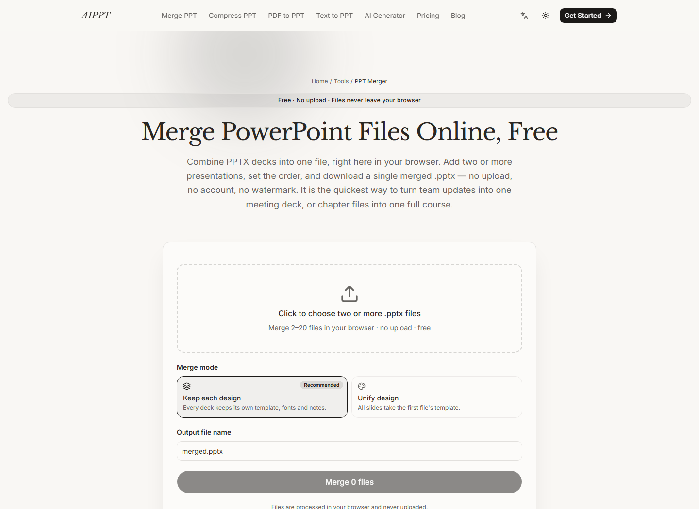
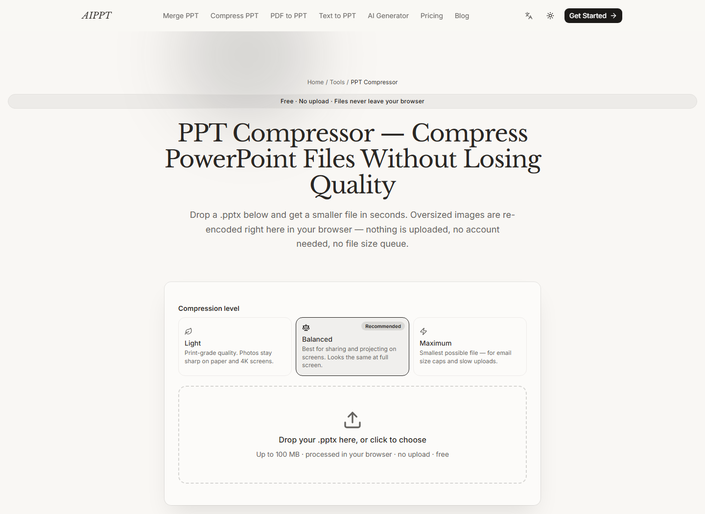

# pptx-merge

<a href="https://aippt.org/merge-ppt"></a>

Merge and compress PowerPoint (.pptx) files **entirely in the browser**. Files are processed locally with JSZip — nothing is uploaded to any server. / 浏览器内处理，文件不上传。

There is no backend in this library. No fetch, no XHR, no upload path in the code at all — you can audit that in two files.





**Live demo: https://aippt.org/merge-ppt**

## What's inside

| File | What it does |
|---|---|
| `src/pptx-merge.ts` | Merge 2–20 .pptx decks into one file. Two modes: `preserve` (each deck keeps its own masters/layouts/theme — designs arrive exactly as authored) and `unify` (all slides restyle onto deck #1's design). |
| `src/pptx-compress.ts` | Shrink heavy decks by re-encoding oversized images (canvas downscale + JPEG re-quantize). Three presets: Light / Balanced / Maximum. Format-preserving: `.png` stays PNG, `.jpeg` stays JPEG, so `[Content_Types].xml` stays truthful. |
| `test/merge.test.mjs` | Self-contained structural test: generates fixtures with pptxgenjs, merges, then verifies every relationship target resolves, content types cover every part, and slide ids stay unique. |

## How the merger works

A .pptx is an OPC package: parts + `.rels` + `[Content_Types].xml`. The merger takes deck #1 as the base and, for every other deck:

1. Finds its slides and walks the relationship closure — layouts, masters, themes, media, notes — copying everything under collision-free `f{i}_`-prefixed names.
2. Rewrites the `Target` paths inside the copied `.rels` (r:id values inside each part stay valid because each part keeps its own rels).
3. Appends to the base `sldIdLst` and presentation rels, and merges `[Content_Types].xml`.

Slide XML is copied byte-identical — text, animations and placeholders arrive exactly as authored. `unify` mode skips the per-deck layout closure and redirects slides onto the base deck's layouts by name instead.

The engine is DOM-free by design (regex surgery on XML strings), so the same code runs in node for structural tests.

## Usage

```bash
npm install jszip        # the only runtime dependency
```

```ts
import { mergePptxFiles } from './src/pptx-merge'; // adjust path / bundler alias

const result = await mergePptxFiles(
  files.map((f) => ({ name: f.name, size: f.size, buffer: await f.arrayBuffer() })),
  { mode: 'preserve' }
);
// result.blob -> File / download; result.slideCount, result.mergedBytes available
```

The compressor runs in the browser (it uses `canvas` for re-encoding):

```ts
import { compressPptx } from './src/pptx-compress';
const out = await compressPptx(file, { level: 'balanced', onProgress });
```

## Tests

```bash
npm install
npm test
```

Covers both merge modes end-to-end plus the error branches (encrypted/OLE files, legacy `.ppt`, corrupt zips, fewer than two files).

## Limitations

- Embedded fonts from source decks are not migrated.
- Compression only re-encodes raster images in `ppt/media/`; vector shapes, fonts and XML are copied byte-identical.
- A re-encoded image replaces the original only when it is actually smaller.

## License

[MIT](LICENSE)

---

Part of [aippt.org](https://aippt.org) — free browser-based PPT tools: [merge](https://aippt.org/merge-ppt), [compress](https://aippt.org/compress-ppt), and AI slide generation.
